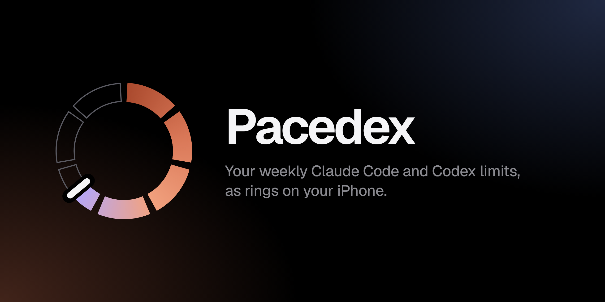
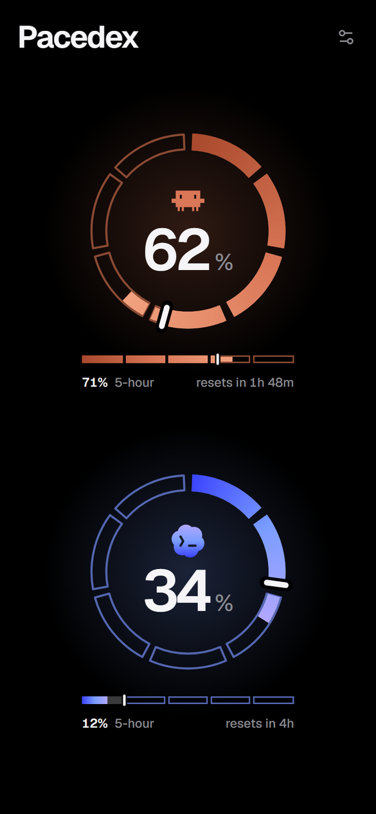
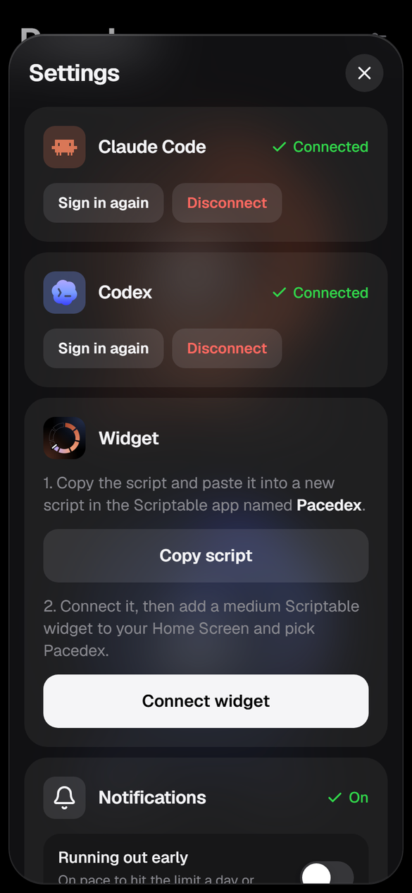

<p align="center"></p>

Pacedex shows how much of your weekly **Claude Code** and **Codex** allowance you've used, and how far through the week you are, on your iPhone's Home Screen. It's a web app, a Scriptable widget and optional notifications, all served by a small Cloudflare Worker that you deploy to your own account.

Nobody else runs it for you. Your sign-ins, your readings and your keys stay in your Cloudflare and GitHub accounts.

<p align="center">
  
  &nbsp;&nbsp;
  
</p>

> [!IMPORTANT]
> This is an unofficial tool. It isn't made, endorsed or supported by Anthropic or OpenAI. It reads usage from endpoints that Claude Code and the Codex CLI use themselves. Those endpoints aren't documented, and they can change or stop working at any time. Read [what it does with your accounts](#what-it-does-with-your-accounts) before you sign in.

## Reading the ring

Each ring is one service's week, starting from that service's own reset at 12 o'clock.

- **Seven segments, one per day.** The days that are gone are solid and the days to come are hollow, so you can count the days left until the reset.
- **The white capsule is now.** It moves through today's segment.
- **Colour is usage, and only usage.** It fills clockwise, from deep to bright. Fill past the capsule means you're ahead of an even pace. Grey is time that has gone by unused.
- **The bar under the ring** is the 5-hour window, drawn the same way in five hour-long segments.
- **Tap a ring** to see when it resets.
- **Nothing inside the ring but the number means everything is current.** If a sign-in expires or readings stop arriving, the meter says so in orange.

## What you need

- An iPhone. Notifications need iOS 16.4 or later and the app added to your Home Screen.
- A Claude Pro or Max plan, a ChatGPT plan that includes Codex, or both. Either one works on its own.
- A free [Cloudflare](https://dash.cloudflare.com/sign-up) account and a [GitHub](https://github.com) account.
- [Node.js](https://nodejs.org) 20 or later on a computer, for the one-time setup.
- Optional: [Scriptable](https://apps.apple.com/app/scriptable/id1405459188) (free) for the Home Screen widget, and the [GitHub CLI](https://cli.github.com) so setup can finish the Codex step for you.

### Why the setup looks like this

Pacedex has no central server. A hosted version would need you to hand someone else your Claude and ChatGPT sign-ins. Here, each part of the setup does a job no single free service can do:

| Part | Its job |
| --- | --- |
| **Cloudflare** | runs your Worker, which keeps readings current around the clock without your computer |
| **GitHub** | runs the Codex relay, because chatgpt.com blocks requests from Cloudflare |
| **Scriptable** | provides the widget, because a web app can't add one to the iPhone Home Screen |

It takes about ten minutes, once. After that there's nothing to run, renew or keep open.

## Set it up

Setup takes about ten minutes.

1. **Make your own copy.** Click **Use this template → Create a new repository**, and choose **Private**. Don't fork it: GitHub turns off scheduled workflows on forks, and the Codex relay is one.
2. **Clone your copy and install:**
   ```sh
   git clone https://github.com/YOU/pacedex.git
   cd pacedex
   npm install
   ```
3. **Run setup:**
   ```sh
   npm run setup
   ```
   Setup signs you in to Cloudflare if you aren't already, then:
   - makes the keys
   - deploys the Worker and creates its storage
   - saves the keys on the Worker
   - adds the relay's two secrets to your GitHub copy, if the GitHub CLI is signed in
   - offers to set up [the Codex watchdog](#optional-the-codex-watchdog), which makes Codex's first reading arrive within a minute
   
   It finishes by printing a QR code and a link.
4. **On your iPhone,** point the camera at the QR code and open the link in Safari, then tap **Share → Add to Home Screen**. The link signs the app in, so treat it like a password.
5. **Open Pacedex from your Home Screen,** tap the settings button, and sign in to Claude, Codex or both:
   - **Claude:** approve on claude.com, then paste back the code it shows you.
   - **Codex:** enter the code shown at auth.openai.com. With the watchdog, the first reading arrives within a minute or so. Without it, the reading comes with the next relay run, which happens every half hour, and the meter shows when that's expected. To get it sooner, run the workflow by hand from your repo's **Actions** tab.
6. **Widget (optional):** in settings, tap **Copy script**. In Scriptable, make a new script named **Pacedex** and paste it in. Back in Pacedex, tap **Connect widget**. Then add a medium Scriptable widget to your Home Screen and choose Pacedex.
7. **Notifications (optional):** in settings, tap **Turn on notifications**.

Setup can be run again at any time. It reuses the keys in `.secrets.local`, so redeploying never signs your phone or widget out.

If the GitHub CLI isn't installed, setup prints the two secrets to add by hand. Add them under **Settings → Secrets and variables → Actions** in your copy:

| Secret | Value |
| --- | --- |
| `WORKER_URL` | your Worker's address, such as `https://pacedex.you.workers.dev` |
| `RELAY_KEY` | the `RELAY_KEY` line in `.secrets.local` |

## Notifications

Each service gets its own notifications, and each one has its own switch:

| Notification | When it's sent |
| --- | --- |
| **Running out early** | You're on pace to hit the limit a day or more before it resets. |
| **Falling behind** | Half the week has gone and you've used less than half your usual share. |
| **Something's wrong** | A sign-in has expired, or there have been no updates for 6 hours. |
| **Weekly summary** (off by default) | The evening or morning before each service resets. |

Notifications are sent only between 8 and 10 AM or 6 and 9 PM in your phone's time zone. Each kind is sent at most once per service per week.

## How it works

```
 iPhone app / widget ──GET /api/usage──▶ Cloudflare Worker ◀── cron, every 10 min
                                              │    │
                     Claude usage, directly ◀─┘    └─▶ Web Push to your phone
                                              ▲
       GitHub Actions, every 30 min ──────────┘  Codex usage, relayed
```

- **The Worker** (`src/worker.js`) holds your sign-ins and refreshes them. It reads Claude's usage every 10 minutes and serves the latest snapshot to the app and the widget. There are no dependencies: everything uses the platform's own `fetch` and WebCrypto.
- **The Codex relay** (`.github/workflows/codex-usage.yml`, `scripts/relay.mjs`) exists because chatgpt.com blocks requests from Cloudflare Workers. Every half hour, a GitHub Actions run asks the Worker for the request to make, makes it from GitHub's network, and posts the raw response back. The relay never stores anything. If the Worker reports a problem, the run fails, and GitHub emails you.
- **Notifications** (`src/notify.js`) are pure functions of the snapshot, the clock and what's already been sent, so the cron, the **Send test** button and the tests all run the same code. Web Push (`src/push.js`) is implemented directly on WebCrypto: VAPID signing ([RFC 8292](https://www.rfc-editor.org/rfc/rfc8292)) and payload encryption ([RFC 8291](https://www.rfc-editor.org/rfc/rfc8291)). It's tested against the RFC's own example.
- **The app** (`public/index.html`) is a single HTML file with no build step. **The widget** (`public/widget/pacedex.js`) draws the same ring with Scriptable's drawing API.

### Costs

Both free tiers cover it comfortably:

- **Cloudflare:** the Worker uses a few hundred requests and KV writes a day, well under the free tier's limits.
- **GitHub Actions:** a private repo gets 2,000 free minutes a month. The relay uses about 1,450 of them (48 short runs a day). Actions minutes are free on public repos.

## What it does with your accounts

These details matter because this tool holds real sign-ins.

- **Claude** signs in with OAuth (PKCE), using the same client ID and scopes as Claude Code's own sign-in, because Anthropic offers no narrower ones. Those scopes would technically allow more than reading usage, including sending requests to Claude. This code calls exactly two endpoints with the token: `api.anthropic.com/api/oauth/usage` and `api.anthropic.com/api/oauth/profile` (for your plan name). It never sends requests to Claude.
- **Codex** signs in with the Codex CLI's device-code flow and client ID. The token is used for one request only: `chatgpt.com/backend-api/wham/usage`.
- **Where the tokens live:** encrypted with AES-GCM in your Worker's KV storage, under a key (`ENC_KEY`) that exists only as a Worker secret and in `.secrets.local` on your computer. The tokens are never written to logs, sent to the app, or stored in the repo. The Codex access token passes through your own GitHub Actions run so the relay can make its one request. It's never printed, and it expires within hours.
- **Who can read your usage:** whoever holds one of three keys. Each key can do only its own job:

  | Key | What it can do |
  | --- | --- |
  | App key | Everything the app needs |
  | Widget key | Read the snapshot, nothing else |
  | Relay key | Only the relay's two routes |

  The Worker compares keys in constant time.
- **Disconnect** in settings deletes that service's tokens and readings from KV. Signing the app out of your Claude or ChatGPT account (or revoking it there) also ends access.
- **Nothing is sent anywhere else.** There's no analytics, no telemetry and no third-party server. The app loads no external scripts or fonts.

Using undocumented endpoints is between you and the services you sign in to. Check their terms if that matters to you.

## Keeping your copy up to date

A template copy doesn't follow this repo automatically. To pull in changes:

```sh
git remote add upstream https://github.com/aniketqxp/pacedex.git
git pull upstream main --allow-unrelated-histories   # only the first time needs the flag
npm run setup
```

## Optional: the Codex watchdog

With a GitHub token, the Worker can start the relay itself. It does this as soon as you sign in to Codex, and whenever Codex readings go stale, since GitHub sometimes runs scheduled workflows late. Setup offers to add the token. To add it later, create a [fine-grained token](https://github.com/settings/personal-access-tokens/new) limited to your copy of the repo, with **Actions: read and write** permission, then run:

```sh
npx wrangler secret put GH_TOKEN
```

The token can only start and read workflow runs in that one repo. Apart from a fresh sign-in, the Worker starts the relay at most once every half hour.

Setup has already saved `GH_REPO` if the GitHub CLI was available. If it wasn't, set that too, as `you/pacedex`.

## Development

```sh
npm test         # notification logic and Web Push encryption
npm run check    # syntax-check every script, then run the tests
npm run deploy   # redeploy after changing code
```

The brand mark is generated by `brand/build.mjs`, so it uses the same ring geometry as the app.

## Licence

[MIT](LICENSE). Third-party fonts, icons and marks are listed in [NOTICE.md](NOTICE.md). Claude and Claude Code are trademarks of Anthropic. Codex and ChatGPT are trademarks of OpenAI. Their marks appear only to label each service's meter.
